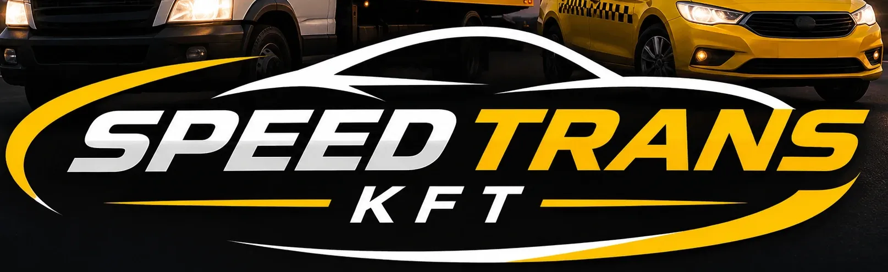
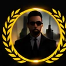

<!doctype html>
<html lang="hu">
<head>
<meta charset="utf-8"><meta name="viewport" content="width=device-width,initial-scale=1">
<meta name="theme-color" content="#08090b"><meta name="description" content="Speed Trans Kft. – Taxi és vontatási szolgáltatás a SeeMTA V4 világában. Alapítva 2026-ban.">
<title>Speed Trans Kft. | Hivatalos céges oldal – SeeMTA V4</title>
<link rel="icon" href="assets/logo.webp" type="image/webp">

</head>
<body>
<header class="header">
<nav class="nav" id="nav"><a class="active" href="#fooldal">⌂ Főoldal</a><a href="#szolgaltatasok">🚕 Szolgáltatások</a><a href="#rolunk">♟ Rólunk</a><a href="#felvetel">▣ Felvétel</a><a href="#kapcsolat">✉ Kapcsolat</a></nav><a class="discord" href="https://discord.gg/53F9EMXxr" target="_blank" rel="noopener noreferrer">🎮 Csatlakozás Discordhoz →</a><button class="menu-btn" id="menu" aria-label="Menü megnyitása" aria-expanded="false">☰ Menü</button>
</header>
<main id="fooldal"><section class="hero">

SEEMTA V4 • TAXI • VONTATÁS
<h1>Speed <em>Trans Kft.</em></h1>
Biztonság. Professzionalizmus. Megbízhatóság.

<strong>2026</strong>-ban alapított cégünk célja, hogy a lehető legjobb szolgáltatást nyújtsa a SeeMTA V4 világában.

<a class="btn btn-primary" href="https://discord.gg/53F9EMXxr" target="_blank" rel="noopener noreferrer">🚕 Taxi szolgáltatás →</a><a class="btn btn-outline" href="https://discord.gg/53F9EMXxr" target="_blank" rel="noopener noreferrer">🚛 Vontatási szolgáltatás →</a>

</section>
<section class="container cards" id="szolgaltatasok" aria-label="Szolgáltatások"><article class="feature">🚕
<h3>Taxi szolgáltatás</h3>
Kényelmes és biztonságos személyszállítás.

</article><article class="feature">🚛
<h3>Vontatás & mentés</h3>
Gyors segítség bárhol, bármikor.

</article><article class="feature" id="felvetel">👥
<h3>Munkatársi felvétel</h3>
Csatlakozz csapatunkhoz, és légy a Speed Trans tagja!

</article><article class="feature">🛡️
<h3>Megbízhatóság</h3>
Mert nálunk az ügyfél az első.

</article><article class="feature">🎧
<h3>Ügyfélszolgálat</h3>
Kérdésed van? Keress minket Discordon!

</article></section>
<section class="container lower" id="rolunk"><article class="panel"><h2>ⓘ Rólunk</h2>
A Speed Trans Kft. egy 2026-ban alapított, fiatal és dinamikus cég, amely a SeeMTA V4 világában taxi- és vontatási szolgáltatást nyújt. Célunk a megbízhatóság, a gyorsaság és az ügyfélközpontú kiszolgálás.
<a class="small-link" href="#bemutatkozas">Tudj meg többet rólunk →</a></article><article class="panel"><h2>🏆 Cégünk adatai</h2>

<b>▦</b> Alapítás éve: <strong>2026</strong>

<b>👥</b> Csapattagok száma: <strong>2 fő</strong>

<b>📍</b> Játékvilág: SeeMTA V4

<b>★</b> Szlogen: „Együtt erősebbek vagyunk!”

</article><article class="panel leaders-panel"><h2>👥 Vezetőség</h2>

<strong>Luis Dorian</strong>Alapító / Tulajdonos

<strong>Dylan De La Fuentes</strong>Ügyvezető

Együtt építjük a jövőt!

</article></section>
<section class="container extra extra-grid" id="bemutatkozas">
<h2>Speed Trans Kft. – Több, mint egy cég!</h2>
Taxi, vontatás és egy összetartó közösség a SeeMTA V4 szerveren. 2026-ban indultunk, jelenleg kétfős csapattal. A szolgáltatások igényléséhez és a jelentkezéshez lépj be a Discord-szerverünkre.

<h2>Kapcsolat és jelentkezés</h2>
A taxi- és vontatási igényeket, valamint a munkatársi jelentkezéseket a Discord-szerverünkön kezeljük.
<a class="btn btn-primary" href="https://discord.gg/53F9EMXxr" target="_blank" rel="noopener noreferrer">🎮 Discord-szerver megnyitása</a>
</section></main>
<footer class="footer">

Speed Trans Kft. – Több, mint egy cég!

Alapítás éve <strong>2026</strong>

Csapattagok <strong>2 fő</strong>

Csatlakozz hozzánk! <a href="https://discord.gg/53F9EMXxr" target="_blank" rel="noopener noreferrer">discord.gg/53F9EMXxr</a>

</footer>

</body></html>
